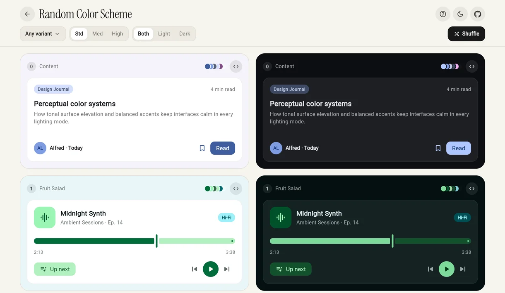
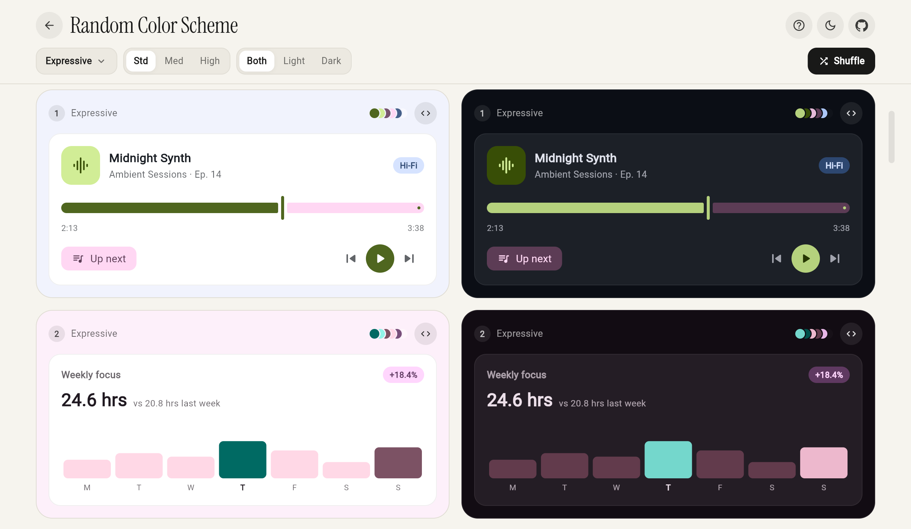
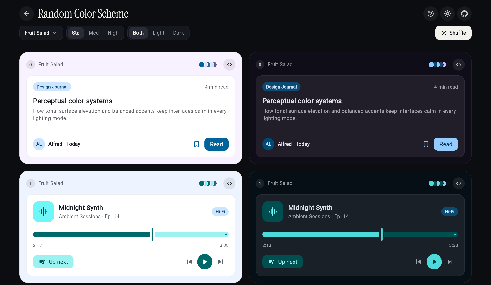

<p align="center">
  
</p>

<h1 align="center">Random Color Scheme</h1>

<p align="center"><strong>Discover your next Flutter theme on every hot reload.</strong></p>

<p align="center">Generate full Material 3 colour schemes from vibrant random seeds across chromatic variants, preview them in light and dark, and copy the Dart code you want to keep.</p>

<p align="center"><a href="https://bernaferrari.github.io/RandomColorScheme/"><strong>Try the live demo ↗</strong></a></p>

<p align="center">
  
</p>

## Usage

[](https://pub.dev/packages/random_color_scheme)

```yaml
dependencies:
  random_color_scheme: ^0.1.5
```

Drop `randomColorSchemeDark()` or `randomColorSchemeLight()` into your `ThemeData`:

```dart
import 'package:material_ui/material_ui.dart';
import 'package:random_color_scheme/random_color_scheme.dart';

ThemeData(
  colorScheme: randomColorSchemeDark(),
)
```

Pass `seed` to lock a palette, `variant` to pin a `DynamicSchemeVariant`, or `contrastLevel` (`0.0`, `0.5`, `1.0`) to adjust contrast. When `shouldPrint` is `true`, the generated `ColorScheme.fromSeed(...)` call is printed to your console so you can paste it back once you find a keeper.

- `randomColorScheme({int? seed, bool isDark = true, DynamicSchemeVariant? variant, double contrastLevel = 0.0, bool shouldPrint = true}): ColorScheme`
- `randomColorSchemeDark({int? seed, DynamicSchemeVariant? variant, double contrastLevel = 0.0, bool shouldPrint = true}): ColorScheme`
- `randomColorSchemeLight({int? seed, DynamicSchemeVariant? variant, double contrastLevel = 0.0, bool shouldPrint = true}): ColorScheme`
- `resolveDynamicSchemeSeed({int? seed, DynamicSchemeVariant? variant}): DynamicSchemeSeed`

## Example

<table>
  <tr>
    <td></td>
    <td></td>
  </tr>
</table>

```sh
git clone https://github.com/bernaferrari/RandomColorScheme.git
cd RandomColorScheme/example
flutter pub get
flutter run -d chrome
```

Random Color Scheme is open source under the [MIT license](LICENSE).
